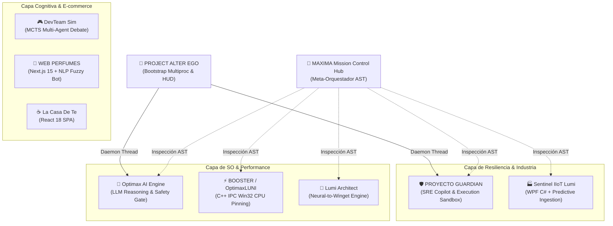

<div align="center">

# ⚡ Maximiliano Agustín Cortez
### **Software Engineer & AI Systems Architect | SRE & Low-Level Specialist**
*Estudiante de Desarrollo de Software en la Facultad de Arquitectura y Urbanismo (FAU - UNT)*

[](https://www.linkedin.com/in/cortezmaximiliano/)
[](#-ecosistema-de-proyectos)
[](mailto:agustincortez975@gmail.com)

```text
> Systems Architecture  |  Autonomous AI Agents  |  Kernel & Low-Level C++  |  SRE & Industrial IIoT
```

---

</div>

## 🌌 Sobre Mí / About Me

Desarrollador de software y diseñador de sistemas enfocado en la **convergencia entre Inteligencia Artificial aplicada, sistemas de bajo nivel de alto rendimiento y resiliencia de infraestructura (SRE)**.

* 🎓 **Formación:** Estudiante de la Tecnicatura en Desarrollo de Software en la **FAU (Universidad Nacional de Tucumán)**.
* 🧠 **Filosofía:** *Arquitectura antes que código*. Diseño de sistemas modulares, tolerantes a fallos y orientados a eventos.
* 🛡️ **Enfoque de Misión Crítica:** Validación de comandos mediante Sandboxes de ejecución aislada para prevenir incidentes en producción.
* ⚡ **Performance & Kernel:** Aislamiento de afinidad de CPU (Win32 API/C++), sockets locales de ultra-baja latencia y comunicación IPC.

---

## 🛠️ Stack Tecnológico

<div align="center">

| Dominio | Tecnologías y Herramientas |
| :--- | :--- |
| **Sistemas & Bajo Nivel** | `C++ (Win32 API)` `C# (.NET 8.0 WPF)` `Named Pipes (IPC)` `PowerShell Core` |
| **IA & Orquestación** | `Autonomous Agents` `Python (AST Parsing)` `FastAPI` `Monte Carlo Tree Search (MCTS)` |
| **SRE, Resiliencia & IIoT**| `Predictive Maintenance` `Sandboxing Decorators` `Telemetry Streaming` `Incident Triage` |
| **Frontend & Web** | `Next.js 15 (App Router)` `React 19 / 18` `TypeScript` `TailwindCSS` `Electron` |
| **Bases de Datos & Cloud** | `Supabase` `PostgreSQL` `WebSockets` `TCP Sockets` `JSONL Audit Stores` |

</div>

---

## 🗺️ Mapa Ecosistémico de Arquitectura

El siguiente mapa refleja la topología jerárquica de mis proyectos, orquestada mediante un núcleo central de metacontrol e inspección de AST:



---

## 🚀 Ecosistema de Proyectos Destacados

### 1. 🛡️ Orquestación, SRE y Sistemas de Resiliencia
* **[PROYECTO GUARDIAN](https://github.com/CortezMaxiI/Guardian-SRE-Copilot):** Copiloto SRE que implementa un decorador `@require_simulation` para forzar la ejecución en Sandbox y triaje humano de cualquier comando emitido por IA antes de llegar a Producción. *(Python, Pydantic, FastAPI, React 19)*
* **[MAXIMA Ecosystem](https://github.com/CortezMaxiI/MAXIMA-Mission-Control):** Centro de mando que analiza el Abstract Syntax Tree (AST) del código fuente para extraer el ADN de la arquitectura y gobernar los subsistemas. *(Python AST, FastAPI, WPF)*
* **[PROJECT ALTER EGO](https://github.com/CortezMaxiI/Project-Alter-Ego):** Orquestador multi-proceso con sockets TCP locales y HUD flotante transparente en tiempo real para Windows. *(Python Subprocess, Win32 HUD)*

### 2. ⚡ Sistemas de Bajo Nivel y Telecomunicaciones Industriales (IIoT)
* **[BOOSTER (OptimaxLUNI)](https://github.com/CortezMaxiI/BOOSTER-OptimaxLUNI):** Módulo en C++ nativo que utiliza la Win32 API y Named Pipes para forzar procesos a operar en afinidades CCX específicas de CPU de ultra-baja latencia. *(C++, Win32 API, IPC)*
* **[Sentinel-IIoT Predictive Lumi Engine](https://github.com/CortezMaxiI/Sentinel-IIoT-Engine):** HMI industrial en C# WPF conectado a un backend de inferencia en Python para predecir fatiga mecánica a partir de telemetría de sensores. *(C# .NET 8, WPF, Sockets)*

### 3. 🧠 Inteligencia Artificial Cognitiva y Orquestación Neural
* **[DevTeam Sim (RIFT-MIND PRO)](https://github.com/CortezMaxiI/DevTeam-Sim-RiftMind):** Motor probabilístico con Búsqueda de Árbol Monte Carlo (AlphaZero MCTS) y debate multi-agente para toma de decisiones tácticas en tiempo real. *(Electron, Node.js, Python)*
* **[Optimax AI Engine](https://github.com/CortezMaxiI/Optimax-AI-Engine):** Motor de razonamiento de telemetría con LLMs y agentes PowerShell gobernados por compuertas de seguridad. *(FastAPI, REST API)*
* **[Lumi Architect](https://github.com/CortezMaxiI/Lumi-Architect):** Motor *Neural-to-Script* que transforma requerimientos en lenguaje natural a manifiestos JSON validados y ejecuciones silenciosas con `winget`. *(Python, PowerShell, React 19)*
* **[TradeVision](https://github.com/CortezMaxiI/TradeVision):** Motor de trading algorítmico y visión de mercado en tiempo real con modelos de inferencia local. *(Python, C# .NET)*

### 4. 🌐 Plataformas Web Modernas & E-commerce
* **[Al-Qamar Perfumes](https://github.com/CortezMaxiI/Al-Qamar-Perfumes):** Plataforma e-commerce completa con Next.js 15 App Router, Supabase (PostgreSQL) y chatbot offline en Python con matching difuso (NLP). *(Next.js 15, Supabase, Python NLP)*
* **[La Casa De Te](https://github.com/CortezMaxiI/La-Casa-De-Te):** Single Page Application en React 18 / TypeScript empaquetada con Vite, guía interactiva de infusión y animaciones fluidas bajo estándar OpenSpec. *(React 18, Vite, TypeScript)*

---

<div align="center">

```text
Construyendo software con bases sólidas, código limpio y mentalidad de ingeniería de sistemas.
```

⭐ *Maximiliano Cortez — 2026*

</div>
